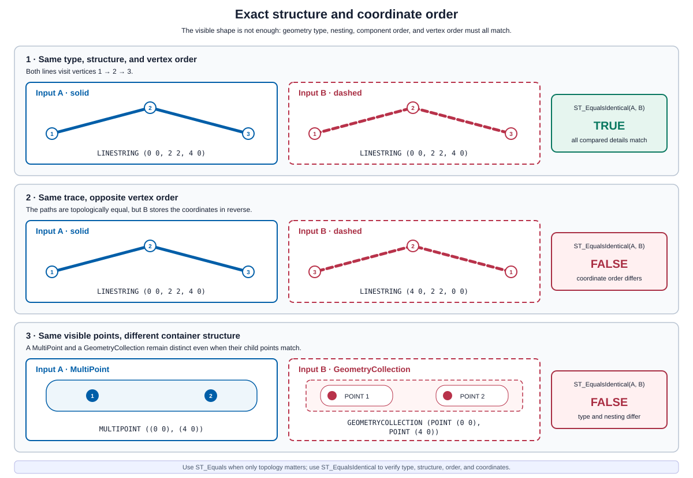
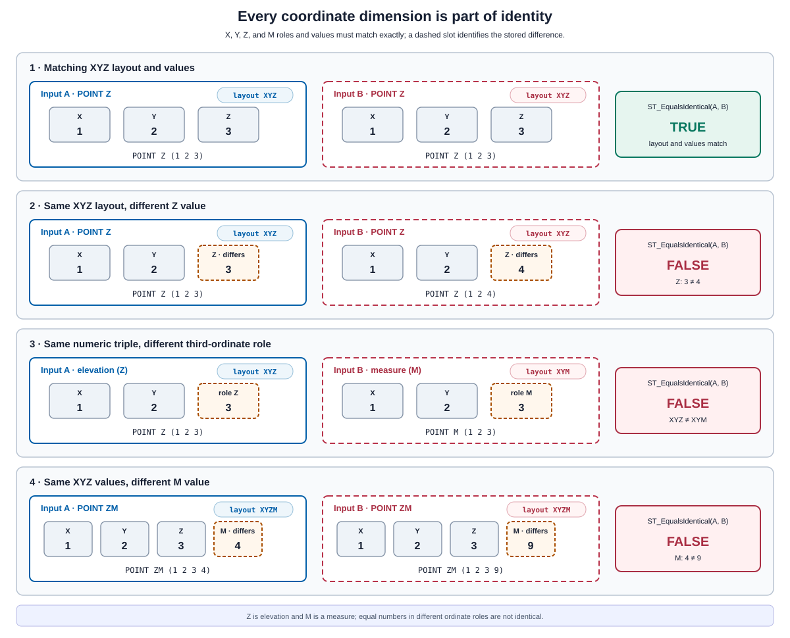

<!--
 Licensed to the Apache Software Foundation (ASF) under one
 or more contributor license agreements.  See the NOTICE file
 distributed with this work for additional information
 regarding copyright ownership.  The ASF licenses this file
 to you under the Apache License, Version 2.0 (the
 "License"); you may not use this file except in compliance
 with the License.  You may obtain a copy of the License at

   http://www.apache.org/licenses/LICENSE-2.0

 Unless required by applicable law or agreed to in writing,
 software distributed under the License is distributed on an
 "AS IS" BASIS, WITHOUT WARRANTIES OR CONDITIONS OF ANY
 KIND, either express or implied.  See the License for the
 specific language governing permissions and limitations
 under the License.
 -->

# ST_EqualsIdentical

当两个几何对象的类型、成员顺序、坐标顺序、维度以及各坐标分量的值都相同时，`ST_EqualsIdentical` 返回 `true`。

`ST_EqualsIdentical` 会精确比较所有坐标维度，包括 Z 和 M。它没有 `ST_EqualsExact` 的容差参数。
如果两个对象在同一位置的同一坐标分量都是 NaN，则该分量视为相等。SRID 等元数据不参与比较。

比较时以几何对象实际存储的维度为准。用 WKT 构造的二维几何对象与写入表后再读出的对象完全相同。
无论使用 `ST_GeomFromWKT` 还是 `ST_GeomFromWKB`，只要坐标序列显式声明了 Z 维度，即使所有 Z 值都是 NaN，Z 维度也参与比较。
例如，`POINT Z (1 2 NaN)` 与 `POINT (1 2)` 在写入表之前和读回之后比较都返回 `false`。
同理，比较 `POINT ZM (1 2 NaN 9)` 与 `POINT M (1 2 9)` 也返回 `false`。

函数签名：`ST_EqualsIdentical(A: Geometry, B: Geometry)`

返回类型：`Boolean`

引入版本：`v2.0.0`

## 图示

### 几何结构与坐标顺序

下图将每个示例的输入 A 和 B 分栏展示，便于比较顶点的遍历方向和几何对象的嵌套结构。
即使两个几何对象覆盖相同的位置，顶点顺序、几何类型或嵌套方式不同也会使比较返回 `false`。



### Z、M 和 ZM 坐标布局

`POINT Z (1 2 3)` 和 `POINT M (1 2 3)` 的数值相同，但第三个数分别表示 Z 和 M，因此这两个点不完全相同。
对于 ZM 几何对象，Z 和 M 都参与比较。



## 如何选择相等性谓词

| 谓词 | 比较条件 | 适用场景 |
| --- | --- | --- |
| `ST_Equals` | 二维拓扑相同，允许几何对象的表示方式和坐标顺序不同 | 查找表示同一形状的几何对象 |
| `ST_EqualsExact` | 结构和顺序相同，对应的 X、Y 坐标在指定容差内，忽略 Z 和 M | 允许 X、Y 坐标存在微小差异 |
| `ST_EqualsIdentical` | 类型、结构、顺序、坐标布局和所有 X、Y、Z、M 分量的值完全相同 | 验证几何对象的表示是否得到保留 |

`ST_EqualsIdentical` 不比较 SRID、精度模型、用户数据或坐标序列的具体实现。如果还要求坐标参考系（CRS）相同，请单独比较 SRID。

对于没有显式维度标记的 JTS XYZ 坐标序列，如果所有 Z 值都是 NaN，Spark 和 Flink 可能将其存储为 XY。
显式标记的空点 `POINT Z EMPTY` 在序列化后仍保留 Z 维度。

`GEOMETRYCOLLECTION` 的每个成员都有自己的坐标布局。若要让所有 Z 值都是 NaN 的点成员保留 Z 维度，请在该点上也写明 `Z`，例如 `GEOMETRYCOLLECTION Z (POINT Z (1 2 NaN))`。
没有成员的集合没有可记录维度的坐标序列，因此比较 `MULTIPOINT Z EMPTY` 和 `MULTIPOINT EMPTY` 会返回 `true`。
序列化时，同一多边形的各个环必须使用相同的坐标布局；同一多点、多线或多面几何对象的各个成员也必须使用相同的布局。

## SQL 示例

### 比较两个完全相同的 XYZ 几何对象

下面两个点的坐标布局和各分量的值都相同。

```sql
SELECT ST_EqualsIdentical(
    ST_GeomFromWKT('POINT Z (1 2 3)'),
    ST_GeomFromWKT('POINT Z (1 2 3)')
)
```

输出：

```text
true
```

### 拓扑相同但坐标顺序不同

两条折线经过相同的位置，因此 `ST_Equals` 返回 `true`。它们的坐标顺序相反，因此 `ST_EqualsIdentical` 返回 `false`。

```sql
WITH paths AS (
    SELECT
        ST_GeomFromWKT('LINESTRING (0 0, 1 1, 2 0)') AS forward_path,
        ST_GeomFromWKT('LINESTRING (2 0, 1 1, 0 0)') AS reverse_path
)
SELECT
    ST_Equals(forward_path, reverse_path) AS same_shape,
    ST_EqualsIdentical(forward_path, reverse_path) AS identical
FROM paths;
```

输出：

```text
same_shape | identical
-----------+----------
true       | false
```

### 比较 Z 和 M 分量

每个坐标分量的值和它所代表的维度都必须匹配。

```sql
SELECT
    ST_EqualsIdentical(
        ST_GeomFromWKT('POINT Z (1 2 3)'),
        ST_GeomFromWKT('POINT Z (1 2 4)')
    ) AS changed_z,
    ST_EqualsIdentical(
        ST_GeomFromWKT('POINT M (1 2 3)'),
        ST_GeomFromWKT('POINT M (1 2 4)')
    ) AS changed_m,
    ST_EqualsIdentical(
        ST_GeomFromWKT('POINT Z (1 2 3)'),
        ST_GeomFromWKT('POINT M (1 2 3)')
    ) AS z_is_not_m,
    ST_EqualsIdentical(
        ST_GeomFromWKT('POINT ZM (1 2 3 4)'),
        ST_GeomFromWKT('POINT ZM (1 2 3 4)')
    ) AS same_xyzm;
```

输出：

```text
changed_z | changed_m | z_is_not_m | same_xyzm
----------+-----------+------------+----------
false     | false     | false      | true
```

### 几何结构与 SRID

几何类型和嵌套结构参与比较，SRID 不参与比较。

```sql
SELECT
    ST_EqualsIdentical(
        ST_GeomFromWKT('MULTIPOINT ((0 0))'),
        ST_GeomFromWKT('GEOMETRYCOLLECTION (POINT (0 0))')
    ) AS different_types,
    ST_EqualsIdentical(
        ST_SetSRID(ST_GeomFromWKT('POINT (1 2)'), 4326),
        ST_SetSRID(ST_GeomFromWKT('POINT (1 2)'), 3857)
    ) AS srid_is_ignored;
```

输出：

```text
different_types | srid_is_ignored
----------------+----------------
false           | true
```

即使比较返回 `true`，两个几何对象的坐标参考系也可能不同。将它们用于同一空间运算之前，请核对 SRID，必要时转换坐标参考系。

### NaN 与 NULL

两个 NaN 位于对应的坐标分量上时视为相等。任一输入为 SQL `NULL` 时，结果为 `NULL`。

```sql
SELECT
    ST_EqualsIdentical(
        ST_GeomFromWKT('POINT (NaN 2)'),
        ST_GeomFromWKT('POINT (NaN 2)')
    ) AS matching_nan,
    ST_EqualsIdentical(
        NULL,
        ST_GeomFromWKT('POINT (1 2)')
    ) AS null_result;
```

输出：

```text
matching_nan | null_result
-------------+------------
true         | NULL
```

## 实际应用：验证写入和读回的几何对象

序列化、存储或 ETL 重写数据后，可以用 `ST_EqualsIdentical` 检查几何对象的表示是否发生变化。
例如，坐标顺序反转、集合类型改变或 Z、M 分量丢失时，即使 `ST_Equals` 仍返回 `true`，`ST_EqualsIdentical` 也能检测到这些变化。

下面的查询分别标记几何对象缺失、表示相同和表示发生变化的记录。

```sql
SELECT
    record_id,
    CASE
        WHEN source_geometry IS NULL OR reloaded_geometry IS NULL THEN 'missing_geometry'
        WHEN ST_EqualsIdentical(source_geometry, reloaded_geometry) THEN 'unchanged'
        ELSE 'changed'
    END AS validation_result
FROM geometry_round_trip;
```

这个谓词比较几何对象的内容。即使两个对象的二进制编码不同，比较也可能返回 `true`。
如果验证还涉及 SRID 或应用程序元数据，请单独检查这些字段。
对于支持拓扑比较的几何类型，可另用 `ST_Equals` 判断变化是否影响拓扑。
