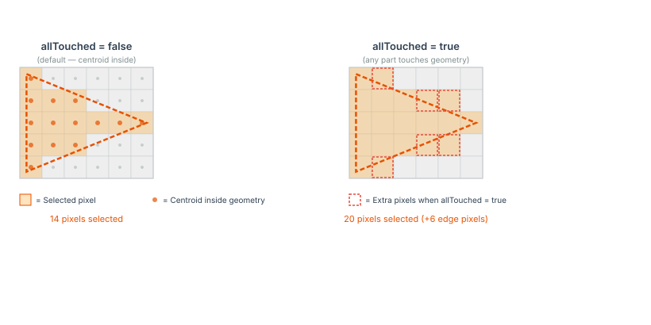
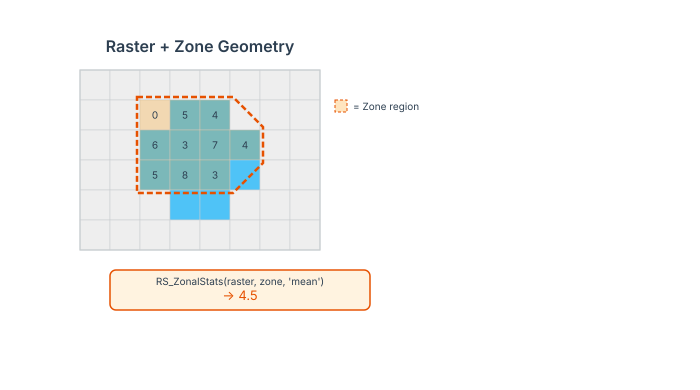

<!--
 Licensed to the Apache Software Foundation (ASF) under one
 or more contributor license agreements.  See the NOTICE file
 distributed with this work for additional information
 regarding copyright ownership.  The ASF licenses this file
 to you under the Apache License, Version 2.0 (the
 "License"); you may not use this file except in compliance
 with the License.  You may obtain a copy of the License at

   http://www.apache.org/licenses/LICENSE-2.0

 Unless required by applicable law or agreed to in writing,
 software distributed under the License is distributed on an
 "AS IS" BASIS, WITHOUT WARRANTIES OR CONDITIONS OF ANY
 KIND, either express or implied.  See the License for the
 specific language governing permissions and limitations
 under the License.
 -->

# RS_ZonalStats

Introduction: This returns a statistic value specified by `statType` over the region of interest defined by `zone`. It computes the statistic from the pixel values within the ROI geometry and returns the result. If the `excludeNoData` parameter is not specified, it will default to `true`. This excludes NoData values from the statistic calculation. Additionally, if the `band` parameter is not provided, band 1 will be used by default for the statistic computation. The valid options for `statType` are:

For polygon geometries, the `allTouched` parameter (Since `v1.7.1`) determines how pixels are selected:

- When true, pixel selection also includes cells entered by the polygon's boundary, following the [RS_AsRaster](../Raster-Operators/RS_AsRaster.md) rules.
- When false (default), pixels whose centroid intersects the polygon will be included.

A polygon never selects a pixel it touches only on the pixel's boundary, whichever edge that is. A polygon aligned with grid lines selects only pixels inside it.

Point geometries select the single pixel containing the point under the half-open rule, regardless of `allTouched`. Line rasterization follows the cells entered by its segments rather than requiring a pixel-centre intersection. A point or line lying on an internal grid edge selects the pixel after it in pixel order; one lying on the raster's last edge selects none. A neighboring pixel contacted only at a line endpoint is not selected unless the segment enters it.



- `count`: Number of pixels in the region.
- `sum`: Sum of pixel values.
- `mean|average|avg`: Arithmetic mean.
- `median`: Middle value in the region.
- `mode`: Most occurring value, if there are multiple values with same occurrence then will return the largest number.
- `stddev|sd`: Standard deviation.
- `variance`: Variance.
- `min`: Minimum value in the region.
- `max`: Maximum value in the region.

!!!note
    If the coordinate reference system (CRS) of the input `zone` geometry differs from that of the `raster`, then `zone` will be transformed to match the CRS of the `raster` before computation.

    The following conditions will throw an `IllegalArgumentException` if they are not met:

    - The provided `raster` and `zone` geometry should intersect when `lenient` parameter is set to `false`.
    - The option provided to `statType` should be valid.

    `lenient` parameter is set to `true` by default. The function will return `null` if the `raster` and `zone` geometry do not intersect.



Format:

```
RS_ZonalStats(raster: Raster, zone: Geometry, statType: String)
```

```
RS_ZonalStats(raster: Raster, zone: Geometry, band: Integer, statType: String)
```

```
RS_ZonalStats(raster: Raster, zone: Geometry, band: Integer, statType: String, allTouched: Boolean)
```

```
RS_ZonalStats(raster: Raster, zone: Geometry, band: Integer, statType: String, allTouched: Boolean, excludeNoData: Boolean)
```

```
RS_ZonalStats(raster: Raster, zone: Geometry, band: Integer, statType: String, allTouched: Boolean, excludeNoData: Boolean, lenient: Boolean)
```

Return type: `Double`

Since: `v1.5.1`

SQL Example

```sql
RS_ZonalStats(rast1, geom1, 1, 'sum', true, false)
```

Output:

```
10690406
```

SQL Example

```sql
RS_ZonalStats(rast2, geom2, 1, 'mean', false, true)
```

Output:

```
226.55992667794473
```
