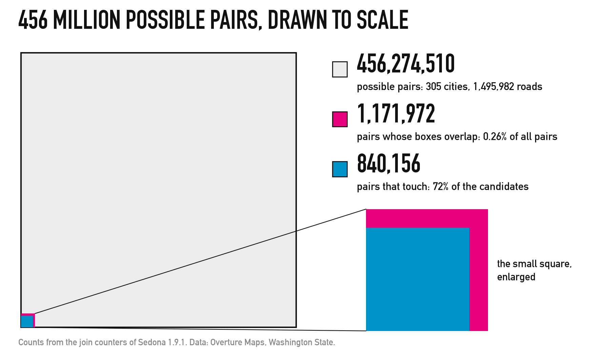
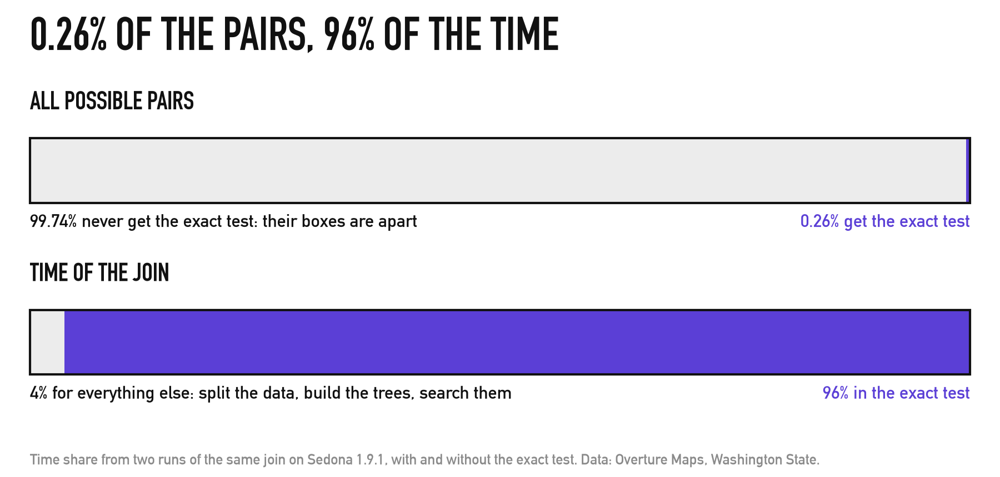

---
date:
  created: 2026-11-20
links:
  - Sedona query optimizer: https://sedona.apache.org/latest/api/sql/Optimizer/
  - "One Sort, Many Indexes": https://sedona.apache.org/latest/blog/2026/11/06/one-sort-many-indexes/
authors:
  - jia
title: "Ask the Box First: Filter and Refine in Apache Sedona"
slug: filter-and-refine
---

# Ask the Box First: Filter and Refine in Apache Sedona

A spatial join asks one question again and again: does this road touch this city? Overture Maps lists 305 cities and towns and 1,495,982 road segments in Washington State, so the join has 456 million pairs to ask about. The exact answer is slow, because the boundary of Tacoma alone is 3,152 points and a road is a line with many points of its own. Apache Sedona asks a cheaper question first.

<!-- more -->

## The filter step asks the box

Every shape has a bounding box, the smallest rectangle that holds it. A box is four numbers, and four comparisons tell whether two boxes overlap. When two boxes are apart, the shapes inside them are apart, and the pair is dropped. When they overlap, the shapes may touch, so the pair becomes a candidate. The box of Tacoma overlaps the boxes of 46,832 roads.

## The R-tree skips most boxes

Comparing every road with all 305 city boxes takes 456 million box tests. Sedona stores the boxes in an R-tree. The tree groups up to ten nearby boxes into a bigger box, then groups those boxes again, until one box covers the state. The 305 city boxes become 35 groups, then 4, then 1.

A search starts at the top and opens only the boxes that overlap the box of the road.

The star is Chambers Creek Road West, 2.9 km long. The search tests the 4 boxes at the top, the 10 boxes inside box B and the 10 city boxes in one of those. After 24 box tests, four candidates are left: Tacoma, University Place, Steilacoom and Lakewood.

## The refine step asks the shape

Only the candidates get the exact test against the real boundary. The road runs through University Place and Steilacoom. Its box overlaps the boxes of Tacoma and Lakewood, and the road never reaches either city. The four exact tests return two matches.

## The whole join

Sedona 1.9.1 counts its own work during a join. For all of Washington, it reported 1,171,972 candidates and 840,156 matches.

The filter step left 0.26% of all pairs. The refine step ran the exact test on those and kept 72% of them.

## The exact test takes most of the time

Now the surprise. The refine step sees 0.26% of the pairs and takes most of the join time. A second run of the same join compared only the boxes and needed 4% of the time. The exact test accounts for the other 96%.

One box test is four comparisons. One exact test against Tacoma checks a road against a boundary of 3,152 points. The [GeoSpark paper](https://doi.org/10.1007/s10707-018-0330-9), where Sedona started, noted that exact tests on complex shapes are time-consuming. A spatial join gets faster with fewer candidates, or with a faster exact test on each candidate.

Every spatial join in Sedona has these two steps. A GeoParquet footer applies the filter step one level up, as [One Sort, Many Indexes](https://sedona.apache.org/latest/blog/2026/11/06/one-sort-many-indexes/) showed. The box of a row group lets a reader skip the whole group.

*Cities and roads from Overture Maps (divisions and transportation themes, release 2026-10-21.0). The tree is the R-tree in Sedona 1.9.1, built over the 305 city boxes. Counts from one `ST_Intersects` join on Sedona 1.9.1 on a laptop, run as a partitioned join. Time share from the same join with and without the exact test, median of three runs each.*
