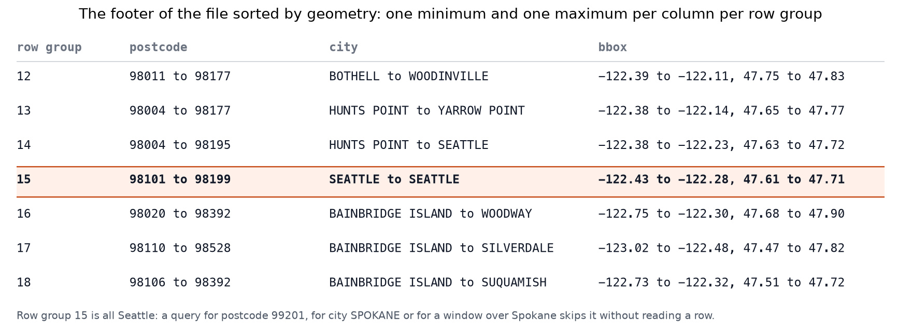
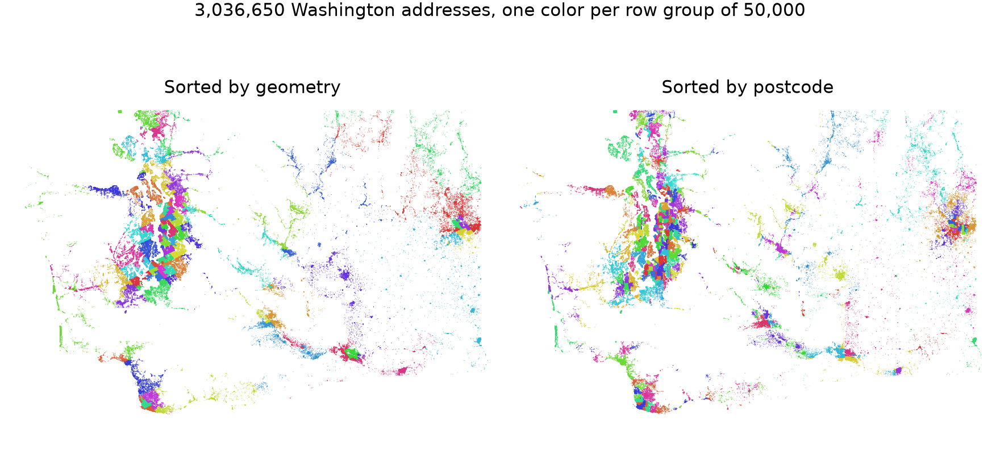

---
date:
  created: 2026-11-06
links:
  - "HERMIT (SIGMOD 2019)": https://dl.acm.org/doi/10.1145/3299869.3319861
  - "ORDER BY Is an Index": https://sedona.apache.org/latest/blog/2026/09/18/order-by-is-an-index-does-it-have-to-be/
  - SedonaDB to_parquet: https://sedona.apache.org/sedonadb/latest/reference/python/
authors:
  - jia
title: "One Sort, Many Indexes: Spatial Correlation in GeoParquet"
slug: one-sort-many-indexes
---

# One Sort, Many Indexes: Spatial Correlation in GeoParquet

*SedonaDB, GeoParquet, and a story that continued at SIGMOD 2019, now in Rust.*

A GeoParquet file has one row order and many columns. In September, [ORDER BY Is an Index](https://sedona.apache.org/latest/blog/2026/09/18/order-by-is-an-index-does-it-have-to-be/) showed that the order is the index, and this post shows that one sort indexes every column that follows the map. Sort 3,036,650 Washington addresses by geometry, and the postcode column gets an index for free. Sort by postcode, and the map gets one. SedonaDB 0.5.0, a database written in Rust, wrote the files and read the footers. The idea comes from [HERMIT](https://dl.acm.org/doi/10.1145/3299869.3319861), which Jia Yu, the original creator of Apache Sedona, co-authored at SIGMOD 2019, one of the top three database conferences alongside VLDB and ICDE.


<!-- more -->

## A soft functional dependency

HERMIT starts from an observation it calls a soft functional dependency: one column predicts another, with exceptions, the way a location predicts a postcode. HERMIT fits a curve from one column to the other, keeps the exceptions in an outlier buffer, and answers a lookup on the second column through the index of the first.

A Parquet footer, the metadata block at the end of the file, holds a cruder curve. The rows are split into row groups of 50,000, and for every column the footer stores the minimum and the maximum inside each group. A reader skips a group when nothing between the two values can match the predicate.



Row group 15 holds 50,000 Seattle addresses: one city, postcodes 98101 to 98199, a bounding box 11 km across. Three indexes from one sort.

## Three layouts

The rows are the Overture addresses of Washington State, read from S3 with one statement. SedonaDB's writer takes a sort key, so the three files differ in that one argument: the S2 cell of each point, which follows a space-filling curve, the postcode, or a random number.

??? example "Three writes"

    ```python
    # pip install "apache-sedona[db]"
    import sedona.db

    sd = sedona.db.connect()
    sd.read_parquet("addr_wa.parquet").to_view("raw")
    sd.sql("""
        SELECT id, postcode, city, street, number, geometry,
               S2_CellIdFromPoint(ST_ToGeography(geometry)) AS s2,
               random() AS rnd
        FROM raw
    """).to_memtable().to_view("b")
    for name, key in {"geo": "s2", "postcode": "postcode", "random": "rnd"}.items():
        sd.sql("SELECT * FROM b").to_parquet(
            f"layout_{name}.parquet",
            sort_by=[key],
            single_file_output=True,
            max_row_group_size=50_000,
            geoparquet_version="1.1",
        )
    ```



The postcode sort groups the map almost as well as the geometry sort, because US postcodes are numbered by area: 980 to 985 around Puget Sound, 986 in the southwest, 988 to 994 east of the Cascades.


Sorted by geometry, the median row group holds 14 distinct postcodes in a range of 220. Nobody sorted this file by postcode, and its footer still holds a postcode index with 61 steps, one per row group. The dependency is soft: 20 addresses carry 83856, an Idaho postcode, and they land in row group 1, where they stretch its range to the whole state. HERMIT keeps an outlier buffer for this case, and a row group has none.

## Nine predicates, three answers

Each predicate ran as a count against each file. SedonaDB's Rust reader checks every predicate against the footer before it reads a row group, and `EXPLAIN ANALYZE` reports how many survived. For postcode 98101 on the geometry file:

```
row_groups_pruned_statistics=61 total → 20 matched
```


- **Postcode 98101**, downtown Seattle: 20 row groups of 61 in the geometry file with no index on postcode, 1 in the postcode file, 61 in the shuffle. With every column returned, that is 33.7 MB, 1.7 MB and 144.2 MB scanned.
- **A window over downtown Seattle**: 3, 23 and 61. Spokane: 6, 9 and 61, and Leavenworth: 2, 8 and 61. The postcode file was never sorted by geometry, and it answers a map query from 8 or 9 row groups. ORDER BY postcode is a spatial index.
- **City SPOKANE**: 46 and 48 of 61. Location predicts the city as well as the postcode, but city names sort alphabetically, and SPOKANE falls between ARLINGTON and STANWOOD, two towns 350 km away. The postcode statistics work because postcode order follows the map.
- **Street MAIN Street and house number 1200**: 61 everywhere. The control.

## What we left open

- **Outliers.** Put the 22 out-of-state rows in their own row group, and row groups 1 and 51 shrink to the ranges of their neighbors.
- **Strings.** A city code that follows the map would prune where the city name cannot.
- **Step width.** 50,000 rows per row group is a guess. [Hippo](https://jiayuasu.github.io/files/paper/hippo_vldb2016_fullpaper.pdf), from the September post, made the same trade with equal-count buckets.

## The point

One sort writes an index for every column that follows the map. HERMIT made it an index in 2019. GeoParquet stores it in the footer, SedonaDB's Rust reader skips by it, and the only decision is the sort key.

*Addresses from Overture Maps (addresses theme, release 2026-10-21.0), sourced from the US National Address Database. Measurements on SedonaDB 0.5.0 on a laptop. HERMIT: "Designing Succinct Secondary Indexing Mechanism by Exploiting Column Correlations", SIGMOD 2019.*
