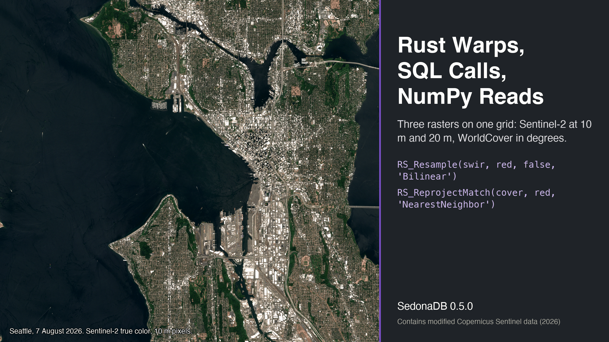
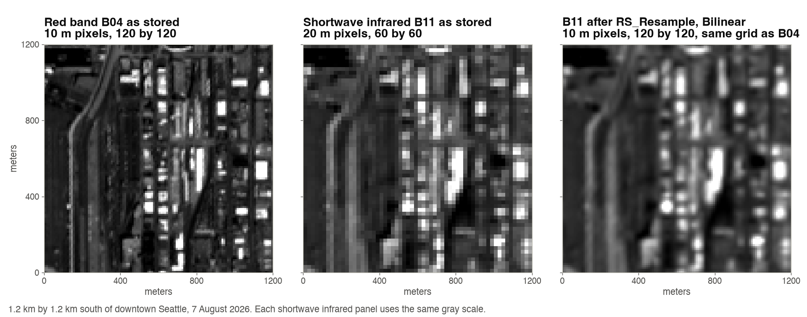
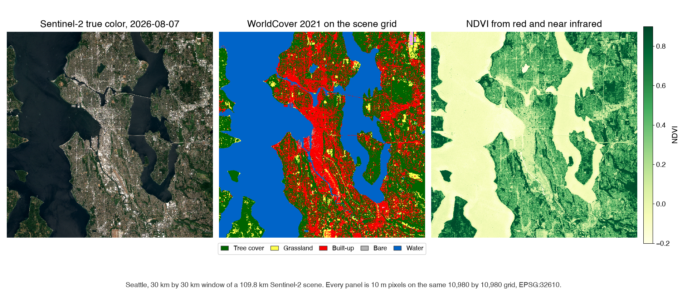
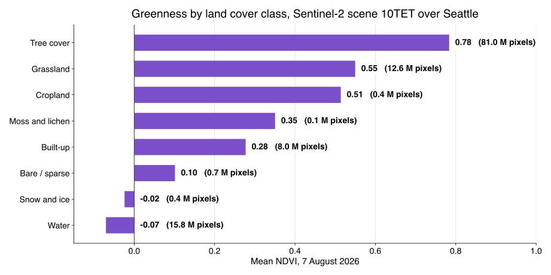
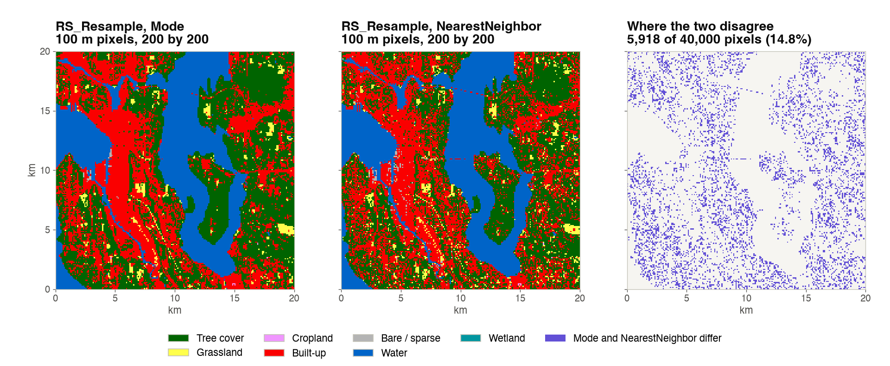

---
date:
  created: 2026-10-23
links:
  - RS_Resample in SedonaDB: https://sedona.apache.org/sedonadb/latest/reference/sql/rs_resample/
  - RS_ReprojectMatch in SedonaDB: https://sedona.apache.org/sedonadb/latest/reference/sql/rs_reprojectmatch/
  - Sentinel-2 COGs on AWS: https://registry.opendata.aws/sentinel-2-l2a-cogs/
authors:
  - jia
title: "Rust Warps, SQL Calls, NumPy Reads: Three Rasters on One Grid"
slug: same-ground-different-pixels
---

# Rust Warps, SQL Calls, NumPy Reads: Three Rasters on One Grid

A satellite image and a land cover map of Seattle do not line up pixel for pixel. Each is a raster, a grid of pixels over the ground, and the grids differ: 10 m and 20 m pixels in the image, pixels measured in degrees in the map. Before any comparison, every pixel has to cover the same patch of ground in every file. SedonaDB 0.5.0, a database written in Rust, lines them up with two SQL functions. `RS_Resample` changes a raster's pixel size, and `RS_ReprojectMatch` moves a raster onto another raster's grid. NumPy then reads the three rasters as arrays of the same shape.



<!-- more -->

## Why the pixels disagree

The image is one Sentinel-2 scene, `S2C_10TET_20260807_0_L2A`, from the public [Sentinel-2 COGs](https://registry.opendata.aws/sentinel-2-l2a-cogs/) bucket, with 0.0008 percent cloud. The map is the ESA WorldCover 2021 tile `N45W123`, the product of [an earlier post](https://sedona.apache.org/latest/blog/2026/10/09/ten-billion-pixels-one-sql-statement/). The scene counts in meters, in UTM zone 10. The tile counts in degrees of latitude and longitude. Over the same 60 m of ground in Seattle, the three grids look like this:


One shortwave infrared pixel holds four red pixels. One WorldCover cell is 6.3 m wide, 9.3 m tall, and tilted 0.5 degree from the scene's grid, because a step of 1/12,000 degree is shorter east to west than north to south at this latitude, and a line of constant longitude is not the scene's vertical. `RS_FromPath` reads the three headers over HTTPS:

```python
import sedona.db
from sedonadb.raster import Raster

sd = sedona.db.connect()

SCENE = "https://sentinel-cogs.s3.us-west-2.amazonaws.com/sentinel-s2-l2a-cogs/10/T/ET/2026/8/S2C_10TET_20260807_0_L2A"
RED, NIR, SWIR = f"{SCENE}/B04.tif", f"{SCENE}/B08.tif", f"{SCENE}/B11.tif"
COVER = "https://esa-worldcover.s3.eu-central-1.amazonaws.com/v200/2021/map/ESA_WorldCover_10m_2021_v200_N45W123_Map.tif"
```

??? example "The query behind the table"

    ```python
    sd.sql(f"""
        SELECT name, RS_FromPath(path) AS r
        FROM (VALUES ('red B04', '{RED}'), ('swir B11', '{SWIR}'), ('land cover', '{COVER}')) AS f(name, path)
    """).to_view("rasters", overwrite=True)

    sd.sql("""
        SELECT name, RS_Width(r) AS width, RS_Height(r) AS height, RS_SRID(r) AS srid,
               RS_ScaleX(r) AS pixel_size, RS_BandPixelType(r, 1) AS pixel_type
        FROM rasters
    """).show()
    ```

```text
┌────────────┬───────┬────────┬────────┬────────────────────────┬─────────────────┐
│    name    ┆ width ┆ height ┆  srid  ┆       pixel_size       ┆    pixel_type   │
╞════════════╪═══════╪════════╪════════╪════════════════════════╪═════════════════╡
│ red B04    ┆ 10980 ┆  10980 ┆  32610 ┆                   10.0 ┆ UNSIGNED_16BITS │
│ swir B11   ┆  5490 ┆   5490 ┆  32610 ┆                   20.0 ┆ UNSIGNED_16BITS │
│ land cover ┆ 36000 ┆  36000 ┆   4326 ┆ 0.00008333333333333333 ┆ UNSIGNED_8BITS  │
└────────────┴───────┴────────┴────────┴────────────────────────┴─────────────────┘
```

## Same CRS, different pixel size

The shortwave infrared band shares the red band's coordinate system, so only the pixel size has to change. `RS_Resample` takes the red band as its reference and returns the shortwave infrared band with the same 10,980 by 10,980 grid:

```python
swir_tbl = sd.sql(f"""
    SELECT RS_Resample(RS_FromPath('{SWIR}'), RS_FromPath('{RED}'), false, 'Bilinear') AS r
""").to_arrow_table()
swir = Raster(swir_tbl["r"], 0).to_numpy()[0]  # (10980, 10980) uint16
```

`Bilinear` gives each 10 m pixel a weighted mix of the four nearest 20 m values, the right choice for a measurement. The `false` says the reference supplies a pixel count; `true` would make it supply a pixel size.



## Different CRS

The land cover map is in degrees. `RS_ReprojectMatch` moves it onto the red band's grid: same coordinate system, same extent, same pixel size, same width and height. The reference contributes only its grid, and its pixels are never read. SedonaDB, written in Rust, calls GDAL's warp for the pixel math.

```python
sd.sql(f"""
    SELECT RS_ReprojectMatch(RS_FromPath('{COVER}'), RS_FromPath('{RED}'), 'NearestNeighbor') AS r
""").to_memtable().to_view("cover_on_grid", overwrite=True)
```

The algorithm is `NearestNeighbor` because the values are class codes. Code 10 is tree cover and code 50 is built-up land; their average, 30, is grassland, and no pixel in Seattle became grassland by being half tree and half roof. `to_memtable` keeps the result in memory, so later queries read the aligned map without computing it again.



## NumPy does the rest

All three rasters now share one grid, so an array index means the same patch of ground in each. `to_numpy` returns each band as a NumPy array, and the normalized difference vegetation index (NDVI), which compares near infrared and red, groups by land cover code with `np.bincount`:

??? example "NDVI per land cover class"

    ```python
    import numpy as np


    def band(path):
        tbl = sd.sql(f"SELECT RS_EnsureLoaded(RS_FromPath('{path}')) AS r").to_arrow_table()
        return Raster(tbl["r"], 0).to_numpy()[0]


    red, nir = band(RED), band(NIR)
    cover = Raster(
        sd.sql("SELECT r FROM cover_on_grid").to_arrow_table()["r"], 0
    ).to_numpy()[0]

    valid = (red > 0) & (nir > 0) & (swir > 0) & (cover > 0)
    r, n = red.astype(np.float32), nir.astype(np.float32)
    with np.errstate(invalid="ignore", divide="ignore"):
        ndvi = (n - r) / (n + r)

    c = cover[valid]
    count = np.bincount(c, minlength=101)
    mean_ndvi = np.bincount(c, weights=ndvi[valid], minlength=101) / np.maximum(count, 1)
    ```



Tree cover is 68 percent of the 119 million valid pixels and averages an NDVI of 0.78. Built-up land averages 0.28, and water is below zero. The same arrays give the moisture index from the shortwave infrared band, where snow on the Cascade peaks scores highest of any class, 0.50.

## Mode or NearestNeighbor

Both functions accept seven algorithms: `NearestNeighbor`, `Bilinear`, `Cubic`, `CubicSpline`, `Lanczos`, `Average`, and `Mode`. Measurements take a weighted mix. Class codes take `NearestNeighbor`, the code under the new pixel's center, or `Mode`, the code that covers most of the new pixel. One query each turns the aligned map into a 100 m map:

```python
sd.sql("SELECT RS_Resample(r, 1098, 1098, false, 'Mode') AS r FROM cover_on_grid")
```



Over the whole scene the two maps disagree on 6.83 percent of the 100 m pixels, and in the 20 km window above on 14.8 percent. Where they disagree, `Mode` says tree cover more than twice as often as `NearestNeighbor`, because a 100 m square in Seattle is often mostly trees with one road or roof under its center. Both queries together took 0.29 seconds from the in-memory view.

## The point

- `RS_Resample` changes the pixel size inside one coordinate system. `RS_ReprojectMatch` moves a raster onto another raster's grid, coordinate system included. Name a reference raster and the output has its width, height, origin and CRS.
- The algorithm is a statement about the data: `Bilinear` for measurements, `NearestNeighbor` or `Mode` for classes.
- Once the grids match, SQL and NumPy share the same pixels. The whole script, every file read over HTTPS, ran in 73 seconds on one machine.

Both functions are marked experimental in the 0.5.0 reference, so their signatures may still change. The [SedonaDB raster introduction](https://sedona.apache.org/latest/blog/2026/09/11/select-from-satellite-in-a-rust-database/) used `RS_ReprojectMatch` to average eleven PlanetScope scenes onto one grid, and the [0.5.0 release post](https://sedona.apache.org/latest/blog/2026/10/13/sedonadb-050-release/) lists the other raster functions that arrived with it.

*Sentinel-2 L2A scene `S2C_10TET_20260807_0_L2A` from the Sentinel-2 COGs bucket; contains modified Copernicus Sentinel data (2026). Land cover from ESA WorldCover 2021 v200, CC BY 4.0; contains modified Copernicus Sentinel data (2021) processed by the ESA WorldCover consortium. Measurements on SedonaDB 0.5.0, one machine with 10 cores. SedonaDB reference: [`RS_Resample`](https://sedona.apache.org/sedonadb/latest/reference/sql/rs_resample/), [`RS_ReprojectMatch`](https://sedona.apache.org/sedonadb/latest/reference/sql/rs_reprojectmatch/), [`RS_FromPath`](https://sedona.apache.org/sedonadb/latest/reference/sql/rs_frompath/).*
