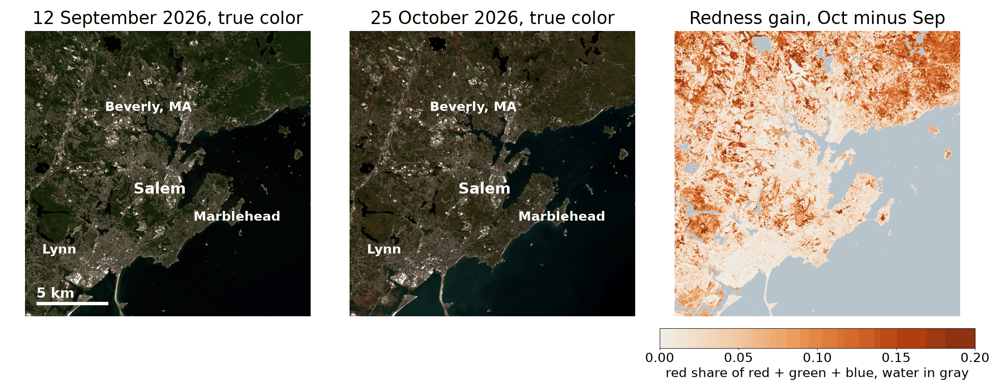
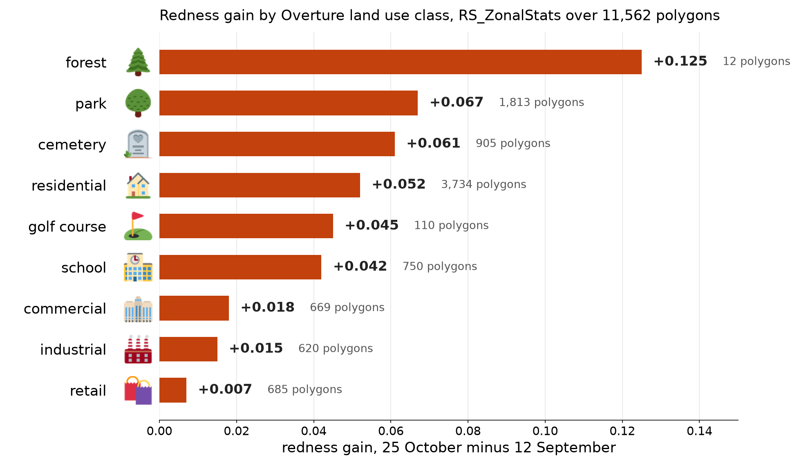
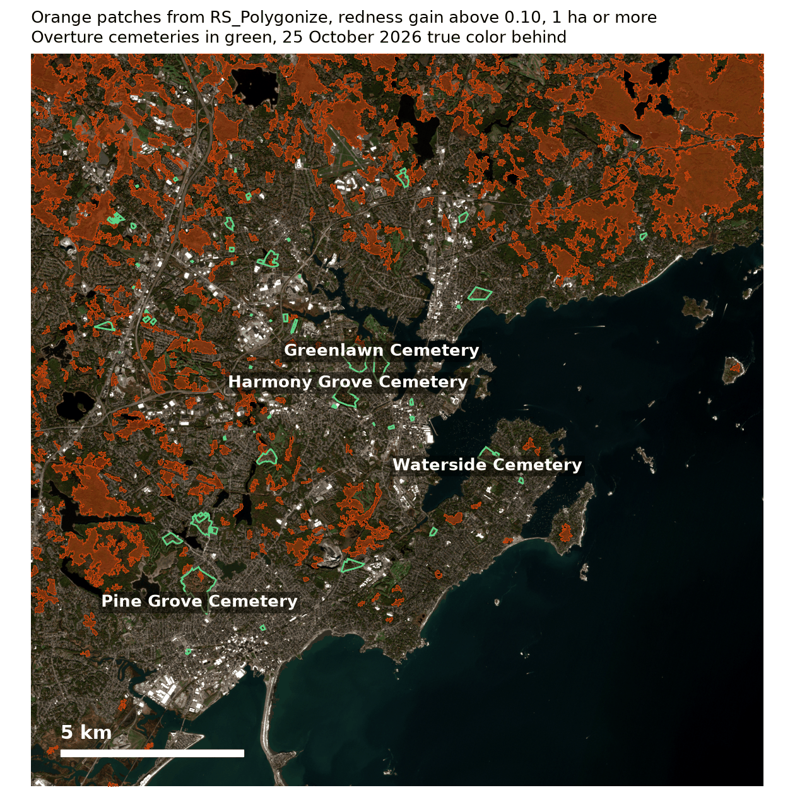

---
date:
  created: 2026-10-30
links:
  - Overture Maps data: https://docs.overturemaps.org/
  - RS_ZonalStats in SedonaDB: https://sedona.apache.org/sedonadb/latest/reference/sql/rs_zonalstats/
  - RS_Polygonize in SedonaDB: https://sedona.apache.org/sedonadb/latest/reference/sql/rs_polygonize/
authors:
  - jia
title: "SedonaDB Ranks Beverly Hills the Second Scariest City in the US. Guess Who Is First."
slug: scariest-city-in-the-us
---

# SedonaDB Ranks Beverly Hills the Second Scariest City in the US. Guess Who Is First.

Beverly Hills has fourteen psychics for 34,979 people. That puts it second on a scare index built from Overture Places: haunted houses, psychics, cemeteries and costume stores per 100,000 residents, for every US city with at least 20,000 people. First place is Salem, Massachusetts, with 45 per 100,000 and a 334-year head start. SedonaDB 0.5.0, a database written in Rust, computed the ranking with one SQL statement that joins the places into city polygons. Then the satellite view: a cloud-free Sentinel-2 image of Salem from 25 October 2026, six days before Halloween, next to one from September, shows how orange the Witch City has turned.


<!-- more -->

## The scare index

Overture Maps publishes [places, divisions and land use](https://docs.overturemaps.org/) as GeoParquet on a public S3 bucket. Each place carries a category such as `haunted_house` or `psychic_advising`, each city is a polygon, and the matching division row carries its population. One statement reads the three tables from S3. `ST_Within` joins each place into the polygon that contains it, and the counts per 100,000 residents fall out:

```python
import sedona.db

sd = sedona.db.connect()
REL = "s3://overturemaps-us-west-2/release/2026-10-21.0"
OPT = {"aws.skip_signature": True, "aws.region": "us-west-2"}
sd.read_parquet(f"{REL}/theme=places/type=place/", options=OPT).to_view(
    "places", overwrite=True
)
sd.read_parquet(f"{REL}/theme=divisions/type=division_area/", options=OPT).to_view(
    "areas", overwrite=True
)
sd.read_parquet(f"{REL}/theme=divisions/type=division/", options=OPT).to_view(
    "divisions", overwrite=True
)

cities = sd.sql("""
    SELECT a.names.primary AS city, a.region, d.population,
           sum(CASE WHEN p.taxonomy.primary = 'haunted_house' THEN 1 ELSE 0 END) AS haunted,
           sum(CASE WHEN p.taxonomy.primary = 'psychic_advising' THEN 1 ELSE 0 END) AS psychics,
           sum(CASE WHEN p.taxonomy.primary = 'cemetery' THEN 1 ELSE 0 END) AS cemeteries,
           sum(CASE WHEN p.taxonomy.primary = 'costume_store' THEN 1 ELSE 0 END) AS costume,
           round(100000.0 * count(*) / d.population, 1) AS per_100k
    FROM areas a
    JOIN divisions d ON a.division_id = d.id
    JOIN places p ON ST_Within(p.geometry, a.geometry)
    WHERE a.country = 'US' AND a.subtype = 'locality' AND d.population >= 20000
      AND p.bbox.xmin > -125.0 AND p.bbox.xmax < -66.9 AND p.bbox.ymin > 24.5 AND p.bbox.ymax < 49.5
      AND p.taxonomy.primary IN ('haunted_house', 'psychic_advising', 'cemetery', 'costume_store')
    GROUP BY a.names.primary, a.region, d.population
    ORDER BY per_100k DESC, d.population DESC
""").to_memtable()
```

The `bbox` columns keep the scan to the contiguous United States, because the Parquet statistics on those columns let SedonaDB skip row groups that fall outside. The statement took 149.5 seconds over HTTPS on one laptop and placed 7,872 places into 1,543 cities.


Salem keeps first place when the floor rises to 30,000 residents and when haunted houses count double. On raw counts New York wins: 16 haunted houses, 310 psychics.

## Salem, six days before Halloween

Sentinel-2 scenes `S2A_19TCH_20260912_0_L2A` and `S2B_19TCH_20261025_0_L2A` cover Salem with no cloud, forty-three days apart, on the same 10 m grid. Autumn is a color change, so the measure is redness: red divided by red plus green plus blue, the same quantity that phenology cameras, fixed cameras that watch a forest change through the year, track each fall. `RS_FromPath` and `RS_EnsureLoaded` read the three visible bands, `to_numpy` hands them to NumPy, and the ratio takes one line.

??? example "Redness from the three visible bands"

    ```python
    from sedonadb.raster import Raster


    def band(path):
        tbl = sd.sql(f"SELECT RS_EnsureLoaded(RS_FromPath('{path}')) AS r").to_arrow_table()
        return Raster(tbl["r"], 0).to_numpy()[0].astype("float32")


    def redness(scene):
        blue, green, red = (
            band(f"{scene}/B02.tif"),
            band(f"{scene}/B03.tif"),
            band(f"{scene}/B04.tif"),
        )
        return red / (red + green + blue)


    SEP = "https://sentinel-cogs.s3.us-west-2.amazonaws.com/sentinel-s2-l2a-cogs/19/T/CH/2026/9/S2A_19TCH_20260912_0_L2A"
    OCT = "https://sentinel-cogs.s3.us-west-2.amazonaws.com/sentinel-s2-l2a-cogs/19/T/CH/2026/10/S2B_19TCH_20261025_0_L2A"
    gain = redness(OCT) - redness(SEP)
    ```



Over the land pixels of the whole tile, redness rose from 0.293 to 0.407, and 54.5 percent of land pixels got redder by more than 0.10.

## Which cemeteries turned first

Overture's land use theme has polygons for cemeteries, parks and golf courses. `RS_ZonalStats` sums each band inside each polygon, once per date, and the ratio of the sums is the polygon's redness:

```python
sd.sql(f"""
    SELECT name, class,
           RS_ZonalStats(red, zone, 1, 'sum') AS red,
           RS_ZonalStats(green, zone, 1, 'sum') AS green,
           RS_ZonalStats(blue, zone, 1, 'sum') AS blue
    FROM (SELECT name, class, ST_Transform(geometry, 'EPSG:32619') AS zone
          FROM land_use WHERE class IN ('cemetery', 'park', 'golf_course'))
    CROSS JOIN (SELECT RS_EnsureLoaded(RS_FromPath('{OCT}/B04.tif')) AS red,
                       RS_EnsureLoaded(RS_FromPath('{OCT}/B03.tif')) AS green,
                       RS_EnsureLoaded(RS_FromPath('{OCT}/B02.tif')) AS blue)
""").to_memtable().to_view("october_sums", overwrite=True)
```

`ST_Transform` moves each polygon from degrees onto the raster's UTM grid, and `RS_EnsureLoaded` reads each band into memory once, so 11,562 polygons took 3.6 seconds for seven statistics each.



In Salem, Greenlawn Cemetery gained 0.059 and Harmony Grove Cemetery 0.058, Charter Street Cemetery next to the haunted houses gained 0.042, and Howard Street Cemetery stayed where it was, 0.399 to 0.389. The three haunted houses downtown gained 0.003 within 300 m, and the three in the New Hampshire woods gained 0.161 to 0.177.

## Orange patches as polygons

A threshold turns the redness gain into a map of orange patches, `Raster.from_numpy` makes that map a raster in memory, and `RS_Polygonize` turns it into polygons that SQL can join with anything else:

```python
import pyarrow as pa
from sedonadb.raster import Raster, RasterType, register_extension_type

orange = (gain[8074:10074, 3417:5417] > 0.10).astype(
    "uint8"
)  # 20 km window, 1 = orange
raster = Raster.from_numpy(
    orange,
    crs="EPSG:32619",
    transform=[334170.0, 10.0, 0.0, 4719260.0, 0.0, -10.0],
    nodata=0,
)
register_extension_type()
storage = pa.array(raster)
sd.create_data_frame(
    pa.table({"r": pa.ExtensionArray.from_storage(RasterType(storage.type), storage)})
).to_view("orange_raster", overwrite=True)

sd.sql("""
    SELECT p['geom'] AS geom, p['value'] AS value
    FROM (SELECT unnest(RS_Polygonize(r, 1)) AS p FROM orange_raster)
""").to_memtable().to_view("patches", overwrite=True)
```



546,450 orange pixels became 42,775 patches in 0.4 seconds, 503 of them a hectare or more. An `ST_Intersects` join with the 72 cemeteries in the window took 0.1 seconds: Harmony Grove Cemetery is 20.5 percent orange patch and Greenlawn Cemetery 19.3 percent, against 9.5 percent for the average cemetery.

## Trick or treat in Salem

The places that made Salem first are points, and `ST_KNN` answers the questions a visitor asks:

```sql
SELECT h.name AS haunted_house, c.name AS candy_store,
       round(ST_Distance(ST_Transform(h.geometry, 'EPSG:32619'), ST_Transform(c.geometry, 'EPSG:32619'))) AS meters
FROM haunted h JOIN candy c ON ST_KNN(h.geometry, c.geometry, 1, true)
```


Salem Haunted Neighborhood is 75 m from Fixx Chocolates and 15 m from Charter Street Cemetery, Witch Mansion is 16 m from a psychic, and ten of the city's twelve psychics have Charter Street Cemetery as their nearest. Each join took under 0.03 seconds.

## The point

- One SQL statement over Overture Places and divisions ranks every US city by any set of categories.
- `RS_ZonalStats` takes Overture polygons as they are, and `RS_EnsureLoaded` loads a band once for thousands of them.
- `Raster.from_numpy` and `RS_Polygonize` close the loop from NumPy back to SQL.

The raster functions are marked experimental in the 0.5.0 reference, so their signatures may still change. [Last week's post](https://sedona.apache.org/latest/blog/2026/10/23/same-ground-different-pixels/) covers rasters that do not share a grid, and the [ten billion pixels post](https://sedona.apache.org/latest/blog/2026/10/09/ten-billion-pixels-one-sql-statement/) runs `RS_ZonalStats` over a whole state.

*Places, divisions and land use from [Overture Maps Foundation](https://overturemaps.org/) release 2026-10-21.0; places under CDLA Permissive 2.0, divisions and land use under ODbL. Sentinel-2 L2A scenes from the Sentinel-2 COGs bucket; contains modified Copernicus Sentinel data (2026). Icons from [Twemoji](https://github.com/jdecked/twemoji), CC BY 4.0. Measurements on SedonaDB 0.5.0, one machine with 10 cores. SedonaDB reference: [`RS_ZonalStats`](https://sedona.apache.org/sedonadb/latest/reference/sql/rs_zonalstats/), [`RS_Polygonize`](https://sedona.apache.org/sedonadb/latest/reference/sql/rs_polygonize/), [`ST_KNN`](https://sedona.apache.org/sedonadb/latest/reference/sql/st_knn/).*
