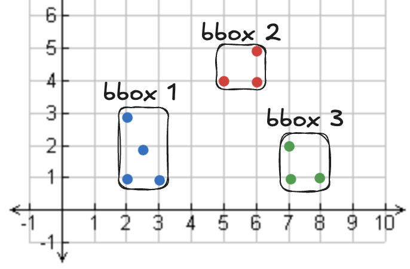
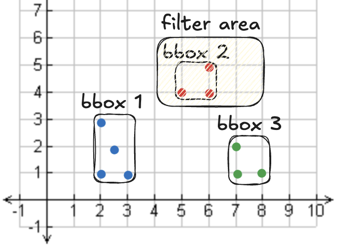

<!--
 Licensed to the Apache Software Foundation (ASF) under one
 or more contributor license agreements.  See the NOTICE file
 distributed with this work for additional information
 regarding copyright ownership.  The ASF licenses this file
 to you under the Apache License, Version 2.0 (the
 "License"); you may not use this file except in compliance
 with the License.  You may obtain a copy of the License at

   http://www.apache.org/licenses/LICENSE-2.0

 Unless required by applicable law or agreed to in writing,
 software distributed under the License is distributed on an
 "AS IS" BASIS, WITHOUT WARRANTIES OR CONDITIONS OF ANY
 KIND, either express or implied.  See the License for the
 specific language governing permissions and limitations
 under the License.
 -->

# Apache Sedona GeoParquet with Spark

This page explains how to build spatial data lakes with Apache Sedona and GeoParquet.

GeoParquet offers many advantages for spatial data sets:

* Built-in support for geometry columns
* GeoParquet's columnar nature allows for column pruning, which speeds up queries that use only a subset of columns.
* Embedded statistics enable readers to skip reading entire chunks of a file in some queries.
* Storing bounding-box metadata (“bbox”) for each row group allows for row-group filtering.
* Columnar file formats are easy to compress.
* You don’t need to infer or manually specify the schema as you would have to with GeoJSON or CSV because GeoParquet includes it in the footer.

Let's see how to write a Sedona DataFrame to GeoParquet files.

## Write Sedona DataFrame to GeoParquet with Spark

Start by creating a Sedona DataFrame:

```python
df = sedona.createDataFrame(
    [
        ("a", "LINESTRING(2.0 5.0,6.0 1.0)"),
        ("b", "LINESTRING(7.0 4.0,9.0 2.0)"),
        ("c", "LINESTRING(1.0 3.0,3.0 1.0)"),
    ],
    ["id", "geometry"],
)
df = df.withColumn("geometry", ST_GeomFromText(col("geometry")))
```

Now write the DataFrame to GeoParquet files:

```python
df.write.format("geoparquet").mode("overwrite").save("/tmp/somewhere")
```

Here are the files created in storage:

```
somewhere/
  _SUCCESS
  part-00000-1c13be9e-6d4c-401e-89d8-739000ad3aba-c000.snappy.parquet
  part-00003-1c13be9e-6d4c-401e-89d8-739000ad3aba-c000.snappy.parquet
  part-00007-1c13be9e-6d4c-401e-89d8-739000ad3aba-c000.snappy.parquet
  part-00011-1c13be9e-6d4c-401e-89d8-739000ad3aba-c000.snappy.parquet
```

Sedona writes many Parquet files in parallel because that's much faster than writing a single file.

GeoParquet writes preserve the declared XY or XYZ coordinate layout of empty `Point`, `LineString`, and `Polygon` geometries. XYZ geometries also retain their Z dimension when Z ordinates are `NaN`.

Sedona writes the Z dimension with the type codes of ISO WKB, which the GeoParquet specification asks for: a geometry with a Z coordinate has a type code from 1001 to 1007, for example 1001 for `Point Z`. Before Sedona 2.0.0 the writer marked Z with the EWKB flag bit instead (`0x80000001` for `Point Z`). Sedona reads both forms.

Each member of a geometry collection keeps its own coordinate layout. A collection with both XY and XYZ members is stored with the type codes of both, for example 1007 for the collection, 2 for an XY `LineString` member and 1001 for a `Point Z` member. ISO WKB requires every member of a collection with a Z coordinate to have one as well, so a reader may reject such a geometry. Spark's native geometry type does: on Spark 4.2 and later, Sedona fails to read it into a native geometry column with `WKB_PARSE_ERROR`.

[GeoParquet 1.1](https://geoparquet.org/releases/v1.1.0/#wkb) does not support M coordinates. Sedona discards M when writing GeoParquet 1.1: XYM becomes XY, and XYZM becomes XYZ. If you need the M values, store them separately before writing, or write GeoParquet 2.0, which keeps them. See the section on writing GeoParquet 2.0 below.

## Read GeoParquet files into Sedona DataFrame with Spark

Let's read the GeoParquet files into a Sedona DataFrame:

```python
df = sedona.read.format("geoparquet").load("/tmp/somewhere")
df.show(truncate=False)
```

Here are the results:

```
+---+---------------------+
|id |geometry             |
+---+---------------------+
|a  |LINESTRING (2 5, 6 1)|
|b  |LINESTRING (7 4, 9 2)|
|c  |LINESTRING (1 3, 3 1)|
+---+---------------------+
```

Since Sedona 2.0.0, reads preserve declared Z/M dimensions even for empty points, lines, and polygons or NaN ordinates. This includes measured WKB inputs, although M coordinates are outside the GeoParquet 1.1 specification. If collecting mixed layouts raises a heterogeneous-layout error, see [ST_Collect](../../api/sql/Geometry-Editors/ST_Collect.md).

Here's how Sedona executes this query under the hood:

1. It fetches the schema from the footer of a GeoParquet file, so no schema inference is needed.
2. It collects the bbox metadata for each file and sees if any data can be skipped.
3. It runs the query, skipping any columns that are not required.

Sedona queries on GeoParquet files can often be executed faster and more reliably than other file formats, like CSV.  CSV files don't store the schema in the file footer, don't support column pruning, and don't have row-group metadata for data skipping.

### Read GeoParquet 2.0 files and Parquet geospatial types

GeoParquet 2.0 stores each geometry column in the `GEOMETRY` or `GEOGRAPHY` logical type of the Parquet format. Since Sedona 2.0.0, the `geoparquet` reader on Spark 4.1 and later reads `GEOMETRY` columns as geometries, in files that carry GeoParquet metadata and in files that carry none. Files written by other engines with only the Parquet logical type therefore load the same way:

```python
df = sedona.read.format("geoparquet").load("/tmp/written-by-another-engine")
```

The SRID of each geometry comes from the `crs` property of the logical type:

| `crs` property of the column | SRID |
| --- | --- |
| absent | 4326 (the Parquet default, OGC:CRS84) |
| `EPSG:<code>` | the code |
| `OGC:CRS84` | 4326 |
| `<authority>:<code>` of another authority, such as `ESRI:102100` | on Spark 4.2 and later, the SRID Spark assigns to it (102100 here); 0 on Spark 4.1 |
| `srid:<identifier>` | the identifier, where `srid:0` means an unknown CRS |
| inline PROJJSON | the SRID of its `id`, by the rules above |
| `projjson:<key>` | the SRID of the `id` of the PROJJSON stored under that file metadata key |

Spark 4.2 ships a registry of EPSG and ESRI coordinate reference systems, and Sedona asks it about authorities other than EPSG. Spark 4.1 has no such registry. The code of such an identifier is never used as the SRID on its own, because an SRID stands for an EPSG code and another authority can use the same number for a different system: `ESRI:4812` is not `EPSG:4812`, so it gives no SRID on any Spark version. The `<key>` of `projjson:<key>` is looked up exactly as written.

A CRS that gives no SRID falls back to the `crs` of the GeoParquet metadata. If that also gives none, the SRID is 0.

On Spark 4.2 and later Sedona infers native Spark geometry types, and such a type has to name its SRID. Reading a column whose CRS gives no SRID therefore fails while Sedona infers the schema, with the message that the CRS cannot be represented by a Spark native SRID. To read the column, give the reader a schema that uses Sedona's own geometry type, `LegacyGeometryType` in Python and `GeometryUDT` in Scala and Java, for it. The geometries then have SRID 0:

```python
from pyspark.sql.types import StructField, StructType
from sedona.spark.sql.types import LegacyGeometryType

schema = StructType([StructField("geometry", LegacyGeometryType())])
df = sedona.read.schema(schema).format("geoparquet").load("/tmp/somewhere")
```

Sedona's functions, such as `ST_AsText` and `ST_Buffer`, accept such a column. Spark's built-in functions, such as `ST_SRID` and `ST_AsBinary` on Spark 4.2, accept native geometry columns only.

`GEOGRAPHY` columns are read as geography columns: Sedona's geography type on Spark 4.1, and Spark's native geography type on Spark 4.2 and later. The SRID comes from the `crs` property by the rules above, so a column without one has SRID 4326, and a column in another geographic CRS, such as NAD83 (`EPSG:4269`), has the SRID of that CRS.

Three kinds of `GEOGRAPHY` columns need a schema from you.

The first is a column whose edges follow an algorithm other than `spherical`, which is `vincenty`, `thomas`, `andoyer` or `karney`. Sedona computes on a sphere, so it rejects the column. A schema in which the column is binary returns its WKB:

```python
from pyspark.sql.types import BinaryType, StructField, StructType

schema = StructType([StructField("geography", BinaryType())])
df = sedona.read.schema(schema).format("geoparquet").load("/tmp/somewhere")
```

The second, on Spark 4.2 and later, is a column whose CRS is unknown or not geographic. Spark's native geography type cannot represent it. A schema with Sedona's own geography type, `LegacyGeographyType` in Python and `GeographyUDT` in Scala and Java, reads the column:

```python
from pyspark.sql.types import StructField, StructType
from sedona.spark.sql.types import LegacyGeographyType

schema = StructType([StructField("geography", LegacyGeographyType())])
df = sedona.read.schema(schema).format("geoparquet").load("/tmp/somewhere")
```

The third, on Spark 4.2 and later, is a column for which the files state different SRIDs. Spark's native geography type names one SRID for a column, so Sedona rejects the read before it scans the files. A schema with the type `GEOGRAPHY(ANY)` for the column reads them, and each geography keeps the SRID of its file:

```python
df = (
    sedona.read.schema("geography GEOGRAPHY(ANY)")
    .format("geoparquet")
    .load("/tmp/somewhere")
)
```

A `GEOGRAPHY` column is not read as a geometry column. Sedona rejects a schema that gives it a geometry type, and it rejects files in which a column is a geometry column in some and a `GEOGRAPHY` column in others. This holds for a geometry column of a GeoParquet 1.x file as well as for a `GEOMETRY` column.

A file that Sedona rejects for one of these reasons is not a corrupt file. The read fails for it with the option `ignoreCorruptFiles` as well, and does not leave the file out.

The files of a dataset do not have to store a geography column in the same way. A file without a geography in the column takes the CRS of the files that have one, whatever CRS it states itself. And a file in which Sedona stored the column as its own geography type, as a GeoParquet 1.1 write does, is read next to files with a `GEOGRAPHY` column. On Spark 4.2 and later a geography without an SRID in such a file has SRID 4326.

A filter on a geography column skips the row groups that the geography of the query is outside of. Sedona reads the bounding box in the geospatial statistics of each row group for it, which is a box on the sphere. It does not use the `bbox` of the GeoParquet metadata of a file, which is planar. See [Push geography predicates to GeoParquet](../../api/sql/Optimizer.md#push-geography-predicates-to-geoparquet).

Spark 3.5 and 4.0 ship a Parquet library that predates these logical types and cannot open such files.

## Inspect GeoParquet metadata

Since v`1.5.1`, Sedona provides a Spark SQL data source `"geoparquet.metadata"` for inspecting GeoParquet metadata. The resulting dataframe contains
the "geo" metadata for each input file.

=== "Scala"

  ```scala
  val df = sedona.read.format("geoparquet.metadata").load(geoparquetdatalocation1)
  df.printSchema()
  ```

=== "Java"

  ```java
  Dataset<Row> df = sedona.read.format("geoparquet.metadata").load(geoparquetdatalocation1)
  df.printSchema()
  ```

=== "Python"

  ```python
  df = sedona.read.format("geoparquet.metadata").load(geoparquetdatalocation1)
  df.printSchema()
  ```

The output will be as follows:

```
root
 |-- path: string (nullable = true)
 |-- version: string (nullable = true)
 |-- primary_column: string (nullable = true)
 |-- columns: map (nullable = true)
 |    |-- key: string
 |    |-- value: struct (valueContainsNull = true)
 |    |    |-- encoding: string (nullable = true)
 |    |    |-- geometry_types: array (nullable = true)
 |    |    |    |-- element: string (containsNull = true)
 |    |    |-- bbox: array (nullable = true)
 |    |    |    |-- element: double (containsNull = true)
 |    |    |-- crs: string (nullable = true)
```

The GeoParquet footer stores the following data for each column:

* geometry_type: type of geometric object like point or polygon
* bbox: bounding box of objects in file
* crs: Coordinate Reference System
* covering: a struct column of xmin, ymin, xmax, ymax that provides the row group statistics for GeoParquet 1.1 files

The rest of the Parquet metadata is stored in the Parquet footer, right where it is stored for other Parquet files too.

If the input Parquet file does not have GeoParquet metadata, the values of `version`, `primary_column` and `columns` fields of the resulting dataframe will be `null`.

`geoparquet.metadata` only supports reading GeoParquet specific metadata. Users can use [G-Research/spark-extension](https://github.com/G-Research/spark-extension/blob/13109b8e43dfba9272c85896ba5e30cfe280426f/PARQUET.md) to read comprehensive metadata of generic Parquet files.

Let’s check out the content of the metadata and the schema:

```
df.show(truncate=False)

+-----------------------------+-------------------------------------------------------------------+
|path                         |columns                                                            |
+-----------------------------+-------------------------------------------------------------------+
|file:/part-00003-1c13.parquet|{geometry -> {WKB, [LineString], [2.0, 1.0, 6.0, 5.0], null, NULL}}|
|file:/part-00007-1c13.parquet|{geometry -> {WKB, [LineString], [7.0, 2.0, 9.0, 4.0], null, NULL}}|
|file:/part-00011-1c13.parquet|{geometry -> {WKB, [LineString], [1.0, 1.0, 3.0, 3.0], null, NULL}}|
|file:/part-00000-1c13.parquet|{geometry -> {WKB, [], [0.0, 0.0, 0.0, 0.0], null, NULL}}          |
+-----------------------------+-------------------------------------------------------------------+
```

The `columns` column contains bounding box information on each file in the GeoParquet data lake.  These bbox values are useful for skipping files or row-groups.  More will come on bbox metadata in the following section.

## Write GeoParquet with CRS Metadata

Since v`1.5.1`, Sedona supports writing GeoParquet files with custom GeoParquet spec version and crs.
The default GeoParquet spec version is `1.1.0` (since `v1.9.0`) and the default crs is `null`. You can specify the GeoParquet spec version and crs as follows:

```scala
val projjson = "{...}" // PROJJSON string for all geometry columns
df.write.format("geoparquet")
    .option("geoparquet.version", "1.0.0")
    .option("geoparquet.crs", projjson)
    .save(geoparquetoutputlocation + "/GeoParquet_File_Name.parquet")
```

If you have multiple geometry columns written to the GeoParquet file, you can specify the CRS for each column.
For example, `g0` and `g1` are two geometry columns in the DataFrame `df`, and you want to specify the CRS for each column as follows:

```scala
val projjson_g0 = "{...}" // PROJJSON string for g0
val projjson_g1 = "{...}" // PROJJSON string for g1
df.write.format("geoparquet")
    .option("geoparquet.version", "1.0.0")
    .option("geoparquet.crs.g0", projjson_g0)
    .option("geoparquet.crs.g1", projjson_g1)
    .save(geoparquetoutputlocation + "/GeoParquet_File_Name.parquet")
```

The value of `geoparquet.crs` and `geoparquet.crs.<column_name>` can be one of the following:

* `"null"`: Explicitly setting `crs` field to `null`. This is the default behavior when geometry SRID is 0.
* `""` (empty string): Omit the `crs` field. This implies that the CRS is [OGC:CRS84](https://www.opengis.net/def/crs/OGC/1.3/CRS84) for CRS-aware implementations.
* `"{...}"` (PROJJSON string): The `crs` field will be set as the PROJJSON object representing the Coordinate Reference System (CRS) of the geometry. You can find the PROJJSON string of a specific CRS from here: https://epsg.io/ (click the JSON option at the bottom of the page). You can also customize your PROJJSON string as needed.

All options of a GeoParquet write are listed in [Parameter](../../api/sql/Parameter.md).

### Automatic CRS from SRID

When no `geoparquet.crs` option is explicitly provided, Sedona will automatically derive the CRS PROJJSON from the SRID of the geometry column. For example, if all geometries in a column have SRID 32632 (set via [`ST_SetSRID`](../../api/sql/Spatial-Reference-System/ST_SetSRID.md)), the writer will automatically produce the PROJJSON for EPSG:32632 in the GeoParquet metadata. For SRID 4326, the CRS field is omitted since this is the GeoParquet default (OGC:CRS84).

* If the SRID is 0 (the default for geometries without an explicit SRID), the `crs` field will be set to `null`.
* If geometries in a column have mixed SRIDs, the `crs` field defaults to `null`.
* If an explicit `geoparquet.crs` or `geoparquet.crs.<column_name>` option is provided, it always takes precedence over the SRID-derived CRS.

On Spark 4.2 and later a native geometry column names its SRID in the column type, and a CRS option for such a column has to agree with it. This applies to every GeoParquet version:

* The identifier of the CRS, which is `id` or an entry of `ids` in the PROJJSON, must give the SRID of the column.
* That identifier must not name a version of its registry. The SRID stands for what the code means today, and a code can mean another CRS in another version, so Sedona rejects the option.
* Sedona compares the identifier only and writes the rest of the definition as given. Make sure that the definition describes the CRS the coordinates are in.

GeoParquet stores WKB coordinates in `(x, y)` order. Per the GeoParquet 1.1
specification, this ordering overrides any axis order declared by the CRS. Sedona
therefore preserves the authoritative CRS axis metadata and does not reorder geometry
coordinates while reading or writing GeoParquet. You can use
[`ST_FlipCoordinates`](../../api/sql/Geometry-Editors/ST_FlipCoordinates.md) when the
coordinates themselves need to be swapped.

## Write GeoParquet 2.0

[GeoParquet 2.0](https://geoparquet.org/releases/v2.0.0/) stores each geometry column in the `GEOMETRY` logical type of the Parquet format. Since Sedona 2.0.0, set `geoparquet.version` to `2.0.0` to write such files on Spark 4.1 and later. The default version is `1.1.0`.

```python
df.write.format("geoparquet").option("geoparquet.version", "2.0.0").save(
    "/tmp/somewhere"
)
```

A GeoParquet 2.0 file differs from a GeoParquet 1.1 file in these ways:

* The geometry column carries the `GEOMETRY` logical type, and the CRS is a property of that type. The GeoParquet metadata repeats the CRS as PROJJSON.
* Each row group has geospatial statistics, a bounding box and the geometry types, which the Parquet library writes. Sedona therefore adds no covering column by default. `geoparquet.covering` and `geoparquet.covering.<column_name>` still declare a covering column that you provide.
* M coordinates are kept: XYM and XYZM geometries are stored as they are. The `geometry_types` of the GeoParquet metadata name the layout, for example `Point M` or `LineString ZM`.
* The `bbox` of the GeoParquet metadata also states the bounds of the Z and M coordinates. A column with Z coordinates has six values, `[xmin, ymin, zmin, xmax, ymax, zmax]`, and a column with Z and M coordinates has eight, `[xmin, ymin, zmin, mmin, xmax, ymax, zmax, mmax]`. A column with M and without Z coordinates has the X and Y bounds only, because GeoParquet has no `bbox` with M bounds and without Z bounds. A Z or M coordinate that is NaN is skipped, and a dimension whose coordinates are all NaN counts as absent, so the array can be shorter than the coordinates of the geometries suggest. Sedona writes no `bbox` for a column when one of the bounds it would list is infinite or NaN, because JSON has no number for such a value. A GeoParquet 1.1 file keeps the four values of the X and Y bounds.

Sedona writes the `crs` property of the column in the shortest form that identifies the CRS:

| CRS of the column | `crs` property of the column | `crs` in the GeoParquet metadata |
| --- | --- | --- |
| OGC:CRS84 (SRID 4326) | absent | absent |
| a CRS with an identifier, such as EPSG:3857 | `EPSG:3857` | PROJJSON |
| a CRS without an identifier | inline PROJJSON | PROJJSON |
| a CRS whose identifier names a version of its registry, such as `IAU` version 2015 | inline PROJJSON | PROJJSON |
| unknown (SRID 0) | `srid:0` | `null` |

On Spark 4.2 and later the CRS comes from the SRID of the column type.

Sedona's `geoparquet` reader returns a geometry column for a GeoParquet 2.0 file. The exception is a column whose CRS gives no SRID, such as PROJJSON without an identifier, on Spark 4.2 and later. Sedona cannot infer a native geometry type for it, so the read fails unless you give a schema with Sedona's own geometry type, as the section on reading GeoParquet 2.0 files shows. What Spark's own Parquet reader, `spark.read.parquet`, returns on Spark 4.2 depends on the column the file was written from. For a native geometry column it returns a native geometry column. For a `GeometryUDT` column, which is every geometry column written on Spark 4.1, it returns the WKB as a binary column, as it does for a GeoParquet 1.1 file.

On Spark 4.1 the SRID belongs to each geometry and not to the column, while a GeoParquet 2.0 column has a single CRS. Sedona takes it from the first geometry of the column in each file, and the write fails if another geometry in that file has a different SRID. A column with SRID 0, or without any geometry in the file, is written with an unknown CRS.

Sedona has to know the CRS before it writes the first row, so it holds the rows before the first geometry in memory, up to 16 MB per file. `geoparquet.srid.lookahead.bytes` changes that limit. A column that has shown no geometry by then is written with an unknown CRS, and a later geometry with an SRID fails the write.

Set `geoparquet.crs` or `geoparquet.crs.<column_name>` to state the CRS yourself. Sedona then writes it as given and does not compare it with the SRIDs of the geometries.

A geography column is stored in the `GEOGRAPHY` logical type with spherical edges, as WKB, and the GeoParquet metadata lists it with `"edges": "spherical"`. A file can have geography columns and no geometry column. Sedona writes no `bbox` for a geography column, because the `bbox` of the GeoParquet metadata is planar.

The row groups of a geography column have geospatial statistics as well. The Parquet library has no algorithm for a geography column, so Sedona computes them: the geometry types, and a bounding box in longitude and latitude. The box covers the edges of the geographies on the sphere and not only their vertices. It reaches a pole for a polygon around that pole, and its `xmin` is above its `xmax` when it crosses the antimeridian, as the Parquet format defines. It has no bounds for Z and M. The Parquet options `parquet.column.statistics.enabled` and `parquet.column.statistics.enabled#<column_name>` turn these statistics off with the value `false`, as they do for the statistics of the Parquet library. An encrypted file gets none.

The CRS of a geography column follows the rules of a geometry column, and `geoparquet.crs` and `geoparquet.crs.<column_name>` apply to it as well. There is one difference on Spark 4.1: a geography without an SRID is written as OGC:CRS84, and so is a column without any geography in the file.

The `GEOGRAPHY` logical type takes a geographic CRS, with longitudes from -180 to 180 and latitudes from -90 to 90. Sedona's own geography type on Spark 4.1 takes any SRID and any coordinates, so a write fails for a geography column whose CRS is a projected one, and for a geography outside these bounds.

A GeoParquet 1.1 file has no geography type. On Spark 4.1 and earlier, Sedona stores a column of its own geography type there in a form that only Sedona reads back. On Spark 4.2 and later a write of a column of Spark's native geography type to a GeoParquet 1.1 file fails, so set `geoparquet.version` to `2.0.0` for it.

Spark 3.5 and 4.0 ship a Parquet library that predates the `GEOMETRY` logical type. Sedona writes GeoParquet 1.1 on these versions and rejects `geoparquet.version` `2.0.0`.

## Save GeoParquet with Covering Metadata

Since `v1.6.1`, Sedona supports writing the [`covering` field](https://github.com/opengeospatial/geoparquet/blob/v1.1.0/format-specs/geoparquet.md#covering) to geometry column metadata. The `covering` field specifies a bounding box column to help accelerate spatial data retrieval. The bounding box column should be a top-level struct column containing `xmin`, `ymin`, `xmax`, `ymax` columns. If the DataFrame you are writing contains such columns, you can specify `.option("geoparquet.covering.<geometryColumnName>", "<coveringColumnName>")` option to write `covering` metadata to GeoParquet files:

```scala
df.write.format("geoparquet")
    .option("geoparquet.covering.geometry", "bbox")
    .save("/path/to/saved_geoparquet.parquet")
```

If the DataFrame has only one geometry column, you can simply specify the `geoparquet.covering` option and omit the geometry column name:

```scala
df.write.format("geoparquet")
    .option("geoparquet.covering", "bbox")
    .save("/path/to/saved_geoparquet.parquet")
```

If you don't set a `geoparquet.covering` option, Sedona will automatically populate covering metadata for GeoParquet `1.1.0`.

For each geometry column, Sedona uses `<geometryColumnName>_bbox` as the covering column:

* If `<geometryColumnName>_bbox` already exists and is a valid covering struct (`xmin`, `ymin`, `xmax`, `ymax`), Sedona reuses it.
* If `<geometryColumnName>_bbox` does not exist, Sedona generates it automatically while writing.

Explicit `geoparquet.covering` or `geoparquet.covering.<geometryColumnName>` options take precedence over the default behavior.

You can control this default behavior with `geoparquet.covering.mode`:

* `auto` (default): enable automatic covering metadata/column generation for GeoParquet `1.1.0`.
* `legacy`: disable automatic covering generation.

```scala
df.write.format("geoparquet")
  .option("geoparquet.covering.mode", "legacy")
  .save("/path/to/saved_geoparquet.parquet")
```

If the DataFrame does not have a covering column, you can construct one using Sedona's SQL functions:

```scala
val df_bbox = df.withColumn("bbox", expr("struct(ST_XMin(geometry) AS xmin, ST_YMin(geometry) AS ymin, ST_XMax(geometry) AS xmax, ST_YMax(geometry) AS ymax)"))
df_bbox.write.format("geoparquet").option("geoparquet.covering.geometry", "bbox").save("/path/to/saved_geoparquet.parquet")
```

## Sort then Save GeoParquet

To maximize the performance of Sedona GeoParquet filter pushdown, we suggest that you sort the data by their geohash values (see [ST_GeoHash](../../api/sql/Geometry-Output/ST_GeoHash.md)) and then save as a GeoParquet file. An example is as follows:

```
SELECT col1, col2, geom, ST_GeoHash(geom, 5) as geohash
FROM spatialDf
ORDER BY geohash
```

Let's look closer at how Sedona uses the GeoParquet bbox metadata to optimize queries.

## Compression of GeoParquet file

There are different options to compress Parquet and GeoParquet files. Using `zstd` is a good choice if you want to distribute your GeoParquet file, see [Best Practices for Distributing GeoParquet](https://github.com/opengeospatial/geoparquet/blob/main/format-specs/distributing-geoparquet.md) and [discussion thread](https://github.com/apache/sedona/discussions/3109#discussioncomment-17666620) for details. Example:

```python
df.write.format("geoparquet").option("compression", "zstd").mode("overwrite").save(
    "path/to/output"
)
```

## How Sedona uses GeoParquet bounding box (bbox) metadata with Spark

The bounding box metadata specifies the area covered by geometric shapes in a given file.  Suppose you query points in a region not covered by the bounding box for a given file.  The engine can skip that entire file when executing the query because it’s known that it does not cover any relevant data.

Skipping entire files of data can massively improve performance.  The more data that’s skipped, the faster the query will run.

Let’s look at an example of a dataset with points and three bounding boxes.



Now, let’s apply a spatial filter to read points within a particular area:



Here is the query:

```python
my_shape = "POLYGON((4.0 3.5, 4.0 6.0, 8.0 6.0, 8.0 4.5, 4.0 3.5))"

res = sedona.sql(f"""
select *
from points
where st_intersects(geometry, ST_GeomFromWKT('{my_shape}'))
""")
res.show(truncate=False)
```

Here are the results:

```
+---+-----------+
|id |geometry   |
+---+-----------+
|e  |POINT (5 4)|
|f  |POINT (6 4)|
|g  |POINT (6 5)|
+---+-----------+
```

We don’t need the data in bounding boxes 1 or 3 to run this query.  We just need points in bounding box 2.  File skipping lets us read one file instead of three for this query.  Here are the bounding boxes for the files in the GeoParquet data lake:

```
+--------------------------------------------------------------+
|columns                                                       |
+--------------------------------------------------------------+
|{geometry -> {WKB, [Point], [2.0, 1.0, 3.0, 3.0], null, NULL}}|
|{geometry -> {WKB, [Point], [7.0, 1.0, 8.0, 2.0], null, NULL}}|
|{geometry -> {WKB, [Point], [5.0, 4.0, 6.0, 5.0], null, NULL}}|
+--------------------------------------------------------------+
```

Skipping entire files can result in massive performance gains.

## Advantages of GeoParquet files

As previously mentioned, GeoParquet files have many advantages over row-oriented files like CSV or GeoJSON:

* Column pruning
* Row group filtering
* Schema in the footer
* Good compressibility because of the columnar data layout

These are huge advantages but don’t offer the complete feature set that spatial data practitioners need.

## Limitations of GeoParquet files

Parquet data lakes and GeoParquet data lakes face many of the same limitations as other data lakes:

* They don’t support reliable transactions
* Some Data Manipulation Language (“DML”) operations (e.g., update, delete) are not supported
* No concurrency protection
* Poor performance compared to databases for certain operations

To overcome these limitations, the data community has migrated to open table formats like Iceberg, Delta Lake, and Hudi.

Iceberg recently rolled out support for geometry and geography columns.  This allows data practitioners to get the best features of open table formats and the benefits of Parquet files, where the data is stored.  Iceberg overcomes the limitations of GeoParquet data lakes and allows for reliable transactions and easy access to common operations like updates and deletes.

## Conclusion

GeoParquet is a significant innovation for the spatial data community.  It provides geo engineers with embedded schemas, performance optimizations, and native support for geometry columns.

Spatial data engineers can also migrate to Iceberg now that it supports all these positive features of GeoParquet, and even more.  Iceberg provides many useful open table features and is almost always a better option than vanilla GeoParquet (except for single file datasets that will never change or for compatibility with other engines).

Switching from legacy file formats like Shapefile, GeoPackage, CSV, GeoJSON to high-performance file formats like GeoParquet/Iceberg should immediately speed up your computational workflows.
